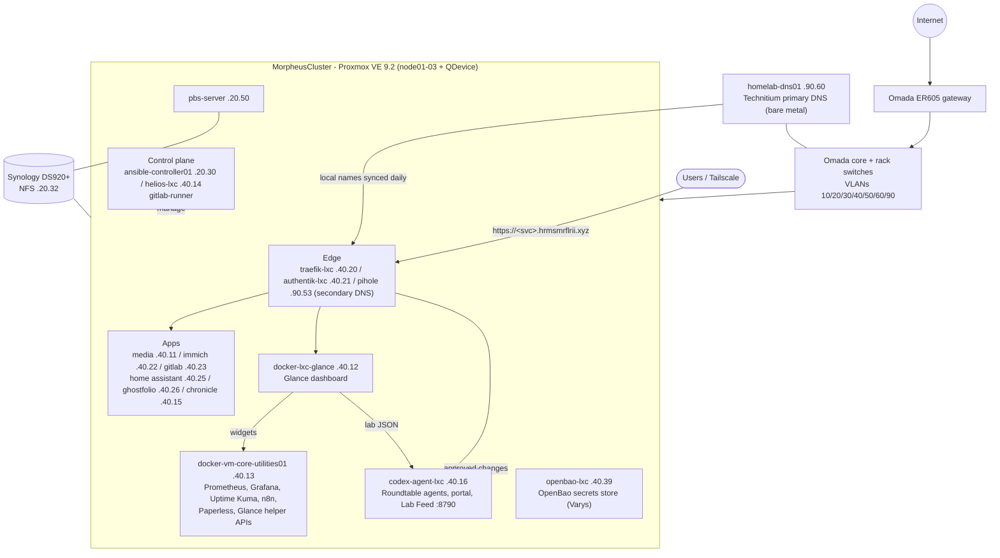
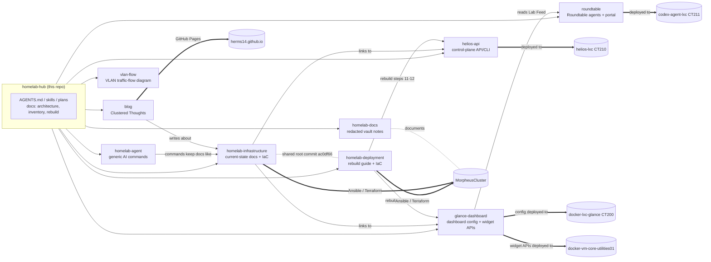

# Architecture

How the homelab fits together, and which repo owns which part.

> Snapshot date: **2026-10-06**. For live numbers see [inventory.md](inventory.md).

## The Lab

Request path: Technitium (homelab-dns01, primary; Pi-hole is the secondary) resolves `<svc>.hrmsmrflrii.xyz` to Traefik. Traefik terminates TLS (Let's Encrypt wildcard via Cloudflare DNS-01). Authentik ForwardAuth enforces SSO where set. Traefik routes to the backend guest.

## Repos and What They Own

| Repo | Deploys to | How it ships |
|------|-----------|--------------|
| `homelab-infrastructure` | Whole cluster | Ansible from `ansible-controller01`, Terraform, Packer |
| `homelab-deployment` | Whole cluster (fresh build) | Same tooling, ordered as a rebuild |
| `helios-api` | helios-lxc (CT210) | Python venv + 3 systemd units (`deploy/systemd/`) |
| `glance-dashboard` | CT200 (Glance) + VM 107 (helper APIs) | Docker Compose, `.env` for secrets |
| `homelab-agent` | Owner's Obsidian vault / any Claude Code project | Copy `commands/` into `.claude/commands/` |
| `blog` | GitHub Pages | Push to `main` triggers `pages-deploy.yml` |
| `homelab-docs` | Nowhere (read on GitHub) | Redacted copy of the vault homelab notes, refreshed by hand |
| `vlan-flow` | docker-vm-core-utilities01 (:8787) | Native Python `vlan-flow.service` (Docker also supported) |
| `roundtable` | codex-agent-lxc (CT211) | Public homelab edition of the private `olympus-agents` deployment repo. Files copied to `~/olympus`, systemd services and timers (`install.sh`) |

## Cross-Repo Touchpoints

Places where one change often needs a matching change elsewhere.

| Topic | Where it lives | Watch out for |
|-------|---------------|---------------|
| Inventory (hosts, IPs, CTIDs) | `infra/README.md`, `deploy/README.md`, `deploy/docs/INVENTORY.md`, [inventory.md](inventory.md) | Update all four together. |
| Glance helper APIs | `glance-dashboard/apis/` **and** `ansible/playbooks/glance/` in both infra repos | Two copies of some APIs (for example `nas-backup-status`). `glance-dashboard` is current. |
| Glance config | `glance-dashboard/config/glance.yml` + `config/pages/` | Older copies inside the infra repos' Ansible playbooks are stale. Lab health widgets read Lab Feed (`roundtable/labfeed.py`). |
| DNS records | Technitium on homelab-dns01 (`roundtable/dns/technitium_setup.py`) | Add local names in Technitium; Torrent's `dnssync.py` copies them to Pi-hole daily. |
| Secrets | OpenBao on openbao-lxc (`roundtable/openbao/`, scopes in `secret_scopes.json`) | Key names only in repos. New keys: add to a scope, run `bao_setup.py`; Varys (`keeper.py`) grants extra scopes only after owner approval. |
| Lab diagrams | `roundtable/atlas_layout.json` | The Hermes Lab Atlas (`https://roundtable.hrmsmrflrii.xyz/atlas`) is redrawn from the live lab by the Roundtable scribe; move or relabel things in the layout file. |
| Helios | `helios-api/` | Infra repos describe it but don't hold its code. |
| Retired tech (K8s, Azure, OPNsense) | Both infra repos | Kept as archived reference. Don't revive. |
| Terraform | `deploy/terraform/proxmox/main.tf` | Still defines retired K8s and syslog VMs. LXCs aren't in Terraform. |
| Rebuild steps | `deploy/README.md` | Mirror changes into [rebuild.md](rebuild.md). |
| Blog posts | `blog/_posts/` | Generated from the vault. Edit the vault note, not the post. |

## Retired

| Component | Retired | Kept as |
|-----------|---------|---------|
| Kubernetes (9 nodes) | 2026-05-23 | Archived docs + `ansible/roles/k8s/` |
| Azure hybrid lab (Arc, Sentinel, DCs) | 2026-05-25 | `Azure-Hybrid-Lab/`, `terraform/azure/` |
| KratosPC Hyper-V | Retired | Helios Hyper-V provider (inactive) |
| OPNsense | Not in use | `ansible/roles/opnsense/` |
